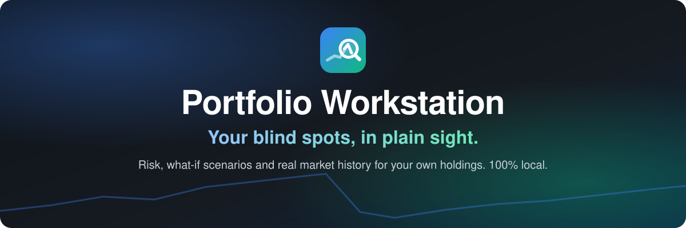
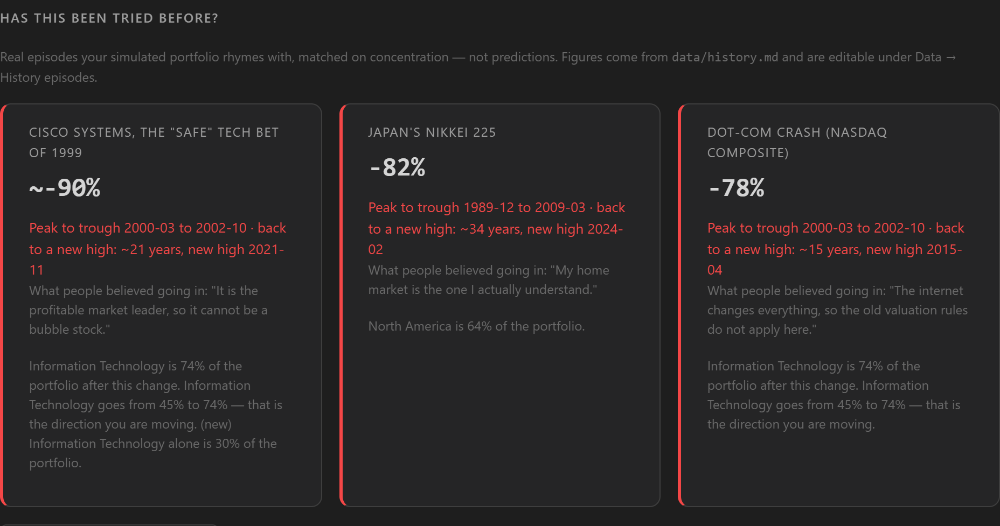
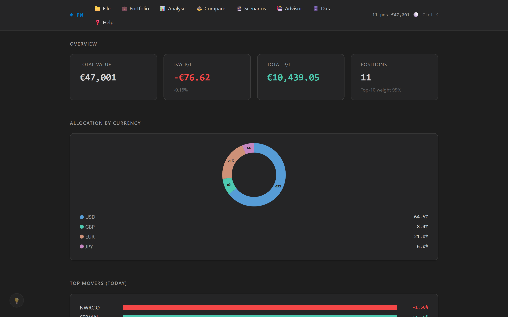
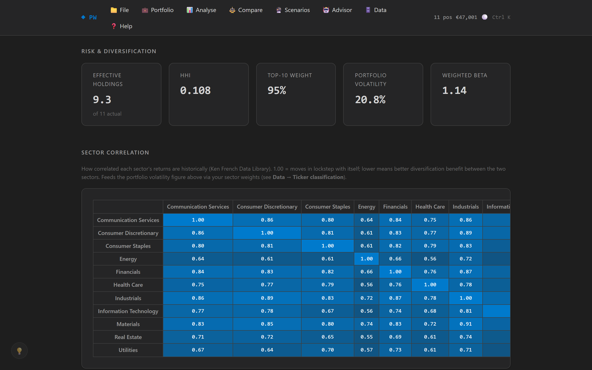
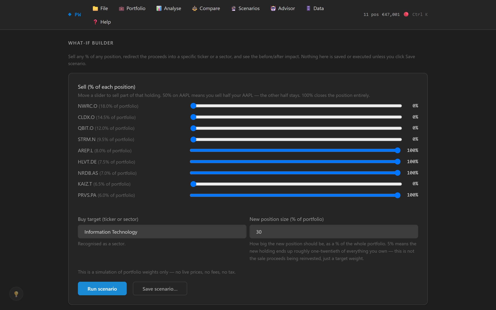
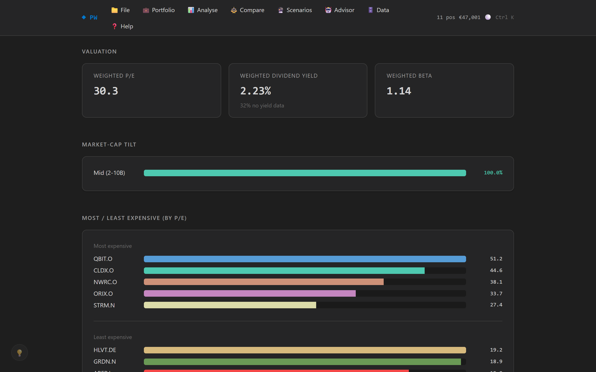

<div align="center">



<br>


[Features](#-features) · [Quick start](#-quick-start) · [How it compares](#-how-it-compares) · [FAQ](#-faq)

<br>



<sub>Shift 30% into tech and the app shows you who made that bet before, and how it ended. (Demo data, invented companies.)</sub>

</div>

## 💡 Why

Tracker apps tell you **what you hold**. This one tells you **what you're not seeing**:

- 🔍 **Blind spots:** concentration, correlation and currency exposure no broker screen puts in front of you.
- 🧪 **Untested assumptions:** "bonds are the safe half", "defensive sectors don't crash", "I know my home market".
- 📜 **Real history, not abstract risk:** go all-in on tech and it tells you the Nasdaq fell **78%** from March 2000 and took **~15 years** to recover.
- 🗣️ **Plain language:** every number comes with a one-line verdict on what it means.

## ✨ Features

<table>
<tr>
<td width="50%"><br><b>Dashboard:</b> total value, P/L, currency split, top movers.</td>
<td width="50%"><br><b>Risk & diversification:</b> volatility, beta, concentration, sector correlation heatmap.</td>
</tr>
<tr>
<td><br><b>What-if builder:</b> sell, buy a sector or ticker, see risk recomputed and matched against real crashes.</td>
<td><br><b>Valuation:</b> weighted P/E, dividend yield, market-cap tilt.</td>
</tr>
</table>

Also inside: momentum ratings, closed positions, per-lot CAGR, progression across exports, ticker classification, a comparison with Buffett, Dalio, Burry and Lynch, a **local AI advisor** (LM Studio) that interprets your figures but is forbidden to invent new ones, plus `Ctrl K` command palette and keyboard shortcuts.

## 🚀 Quick start

1. **Get it:** `git clone https://github.com/thiagobra/portfolio-investor-comparison.git`
2. **Run it:** `python serve.py` (or double-click `start.bat` on Windows), then open <http://127.0.0.1:8420>
3. **Load your data:** File → *Import Investing.com CSV…* ([format reference](docs/csv-format.md))

No install step: just Python 3, standard library only.

<details>
<summary>Use another port</summary>

```bash
PORT=9000 python serve.py          # macOS / Linux
$env:PORT=9000; python serve.py    # Windows PowerShell
```
</details>

## ⚖️ How it compares

| | This app | Getquin | InvestingPro |
|---|:---:|:---:|:---:|
| Tracks holdings and P/L | ✅ | ✅ | ✅ |
| Portfolio-level volatility, beta, correlation | ✅ | ❌ | ❌ |
| Free-form what-if with risk recomputed | ✅ | ❌ | ❌ |
| Matches your bet against real historical crashes | ✅ | ❌ | ❌ |
| AI runs on your own PC | ✅ | ❌ | ❌ |
| Free and open source | ✅ | ❌ | ❌ |

## ❓ FAQ

<details>
<summary><b>Does my data leave my computer?</b></summary>

No. The server binds to `127.0.0.1`, your files live in the gitignored `private/` folder, and the AI advisor talks only to LM Studio on your own machine.
</details>

<details>
<summary><b>Do I need the AI part?</b></summary>

No. Every screen works without it. [LM Studio](https://lmstudio.ai) only adds the advisor chat and the "What am I not seeing?" reading.
</details>

<details>
<summary><b>Where do the historical figures come from?</b></summary>

From [`data/history.md`](data/history.md), a committed, editable reference file, matched by plain code, never generated by a model. Sources for the other reference data are in [`docs/data-sources.md`](docs/data-sources.md).
</details>

<details>
<summary><b>How do I add an investor to Compare?</b></summary>

Copy an existing `data/*.md` investor file, add its ID to `INVESTOR_FILES` in `js/investors-loader.js`, and add an `investor-card` button in `index.html`.
</details>

## 🤝 Contributing

Got an idea? Use the 💡 button in the app: it opens a prefilled GitHub issue. Developers: start with [`docs/MAP.md`](docs/MAP.md) (every module, one line each) and [`docs/metrics.md`](docs/metrics.md) (every formula).

## 📄 License

[MIT](LICENSE)
